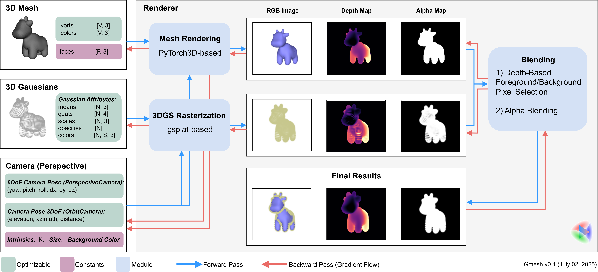

<p align="center">
    
</p>

<h1 align="center">Differentiable Hybrid Renderer for 3D Gaussians & Mesh</h1>


<a href="https://opensource.org/licenses/MIT">

</a>

**Current Version**: v0.1 (July 02, 2025)

## TL;DR

- Combining Gaussians and meshes lets you leverage the strengths of both for more flexible and realistic 3D scene rendering.
- Gmesh supports differentiable rendering of mixed 3D Gaussians and meshes within a single scene.
- Built on gsplat and PyTorch3D, Gmesh is fully PyTorch-native.


## Examples

Please see ```./examples```:

1. 3D Mesh Rendering via Pytorch3D: [Link](./examples/example-1%20-%20mesh%20rendering.ipynb)
2. 3DGS via gsplat: [Link](./examples/example-2%20-%20gaussian%20splatting.ipynb)
3. Hybrid Gaussians and Mesh Rendering via Gmesh: [Link](./examples/example-3%20-%20gmesh%20hybrid%20rendering.ipynb)


## Setup


```bash
# create conda virtual environment
conda create --name gmesh -y python=3.10
conda activate gmesh

# install cuda toolkit
conda install -c "nvidia/label/cuda-11.7.1" cuda-toolkit ninja
conda install -c conda-forge cudatoolkit=11.7 cudatoolkit-dev=11.7

# install PyTorch
pip install torch==2.0.1 torchvision --index-url https://download.pytorch.org/whl/cu117

# install other dependencies
pip install -r requirements.txt

# install Gmesh
pip install -e .
```

> [!TIP]
> I have only tested the following library versions:
> ```CUDA 11.7```, ```PyTorch 2.0.1```, ```PyTorch3D V0.7.8```, and ```gsplat v1.5.2```.
> If you encounter any issues or unexpected results, please double-check that you have installed the correct versions.


## Design Details

<p align="center">
    <b>Pipeline</b><br>
    
</p>

### Z-buffer hybrid rendering (default)

The mesh is rendered first with PyTorch3D, and its z-buffer is passed to the Gaussian rasterizer. While alpha
compositing front-to-back, every Gaussian is depth-tested against the mesh z-buffer **per pixel**: Gaussians in
front of the mesh surface are composited, Gaussians behind it are dropped, and the opaque mesh (or the background
where there is no mesh) is the last layer:

```
C(p) = sum_{i : z_i < D_mesh(p)} c_i * a_i * T_i  +  T_cut(p) * C_mesh(p)
```

This is implemented as a small CUDA extension (`gmesh/renderer/csrc`) that adds the depth test to gsplat's
forward rasterization kernel. The backward pass reuses gsplat's own backward kernel, which is exactly consistent
with the depth-limited forward pass, so gradients flow to all Gaussian attributes and to the mesh colors.
The extension is JIT-compiled the first time it is used (this needs `nvcc` and `ninja`, see Setup, and takes about
a minute).

```python
gmesh_renderer = GmeshRenderer(camera=camera, tile_size=16, bg_color=(1.0, 1.0, 1.0), depth_bias=0.0)
rgb, depth, alpha = gmesh_renderer.render(mesh=mesh, gaussians=gaussians, camera_pose=camera_pose)
```

- `depth_bias`: Gaussians are depth-tested by their center depth, so Gaussians lying exactly on the mesh surface
  are cut in half (z-fighting). A small positive bias (in scene units) moves the depth test slightly behind
  the surface.
- `mode='depth_blend'`: the previous behavior, which renders mesh and Gaussians separately and blends the two
  images by comparing their depth maps.

> [!NOTE]
> The z-test is a hard per-pixel test, so it gives no gradients w.r.t. *which* Gaussians are occluded
> (i.e. Gaussian depth relative to the mesh). Gradients w.r.t. the visible Gaussians and mesh colors are exact.

<p align="center">
    <b>Camera Coordinates</b><br>
    
</p>


## Tests

The tests need a CUDA GPU (the renderer tests also need PyTorch3D and open3d):

```bash
python -m pytest tests -v
```

They check the z-buffer rasterizer against gsplat (no occluder) and against a brute-force PyTorch reference
(with an occluder), for both the forward pass and the gradients, and check that the mesh renderer is pixel- and
depth-aligned with gsplat.


## Demo

You can play with our interactive demonstration to see the rendering results: 

```bash
python interactive_demo.py
```

<p align="center">
    <a href="https://www.youtube.com/watch?v=iVwSZtwr9GI">
        
    </a>
    <br>
    <a href="https://www.youtube.com/watch?v=iVwSZtwr9GI">Watch the demo video on YouTube</a>
</p>


## Limitations and Todos

### The current version has the following main limitations:
- Gaussians are depth-tested by their center depth (as in 3DGS sorting), so Gaussians intersecting the mesh surface are either fully in front or fully behind it at each pixel (see `depth_bias`).
- The z-buffer mode supports one opaque mesh layer (no transparent meshes).
- 3D Gaussians' are not relightable.
- Does not support mesh opacity.
- Does not support mesh texture map.
- Does not support batch rendering.

### Todos:
- [x] Support z-buffering.
- [ ] Support mesh texture map.
- [ ] Support batch (batch of camera poses) rendering.
- [ ] Add two additional mesh to Gaussians conversion methods.
- [ ] Add some training examples.


## Acknowledgement and Disclaimer

The code can be used for research purposes, **provided that the terms of the licenses of any third-party libraries, data or dependencies are followed**. For commercial use, the parts of code we wrote are for free, but please be aware to get permissions from any third-party to use their code or dependencies. We do not assume any responsibility for any issues, damages, or liabilities that may arise from the use of this code. Users are responsible for ensuring compliance with any legal requirements, including licensing terms and conditions, and for verifying that the code is suitable for their intended purposes.

> [!NOTE]
> The example 3D mesh used in ./assets/data/spot.obj is sourced from: https://www.cs.cmu.edu/~kmcrane/Projects/ModelRepository/#spot. Please ensure you adhere to the license agreement provided on that site. We do not claim ownership of this mesh file.


## 🧸 Citation

Please cite this work if you find it useful in your projects. 

```bibtex
@software{Yan_GMesh_Differentiable_Hybrid_2025,
    author = {Yan, Peizhi},
    month = jul,
    title = {{GMesh: Differentiable Hybrid Renderer for 3D Gaussians and Meshes}},
    url = {https://github.com/PeizhiYan/gmesh},
    version = {0.1},
    year = {2025}
}
```

