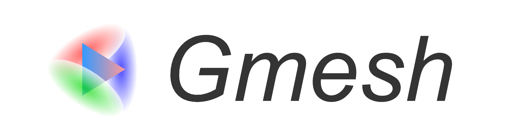
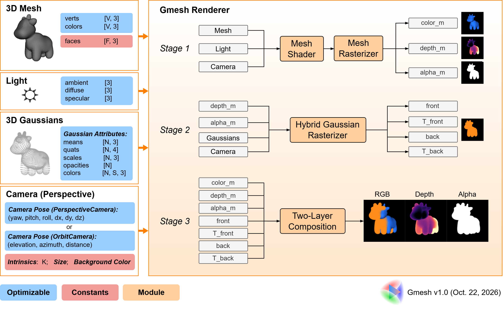
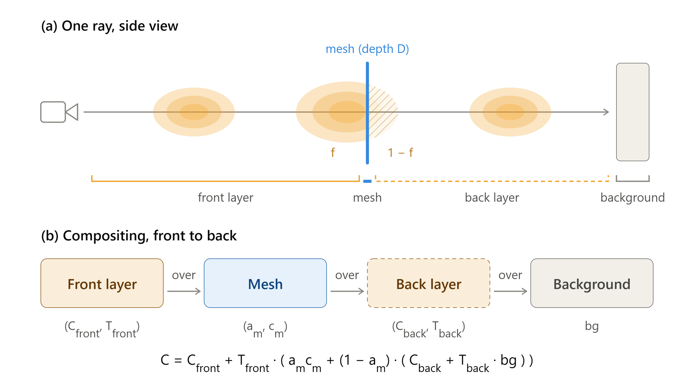
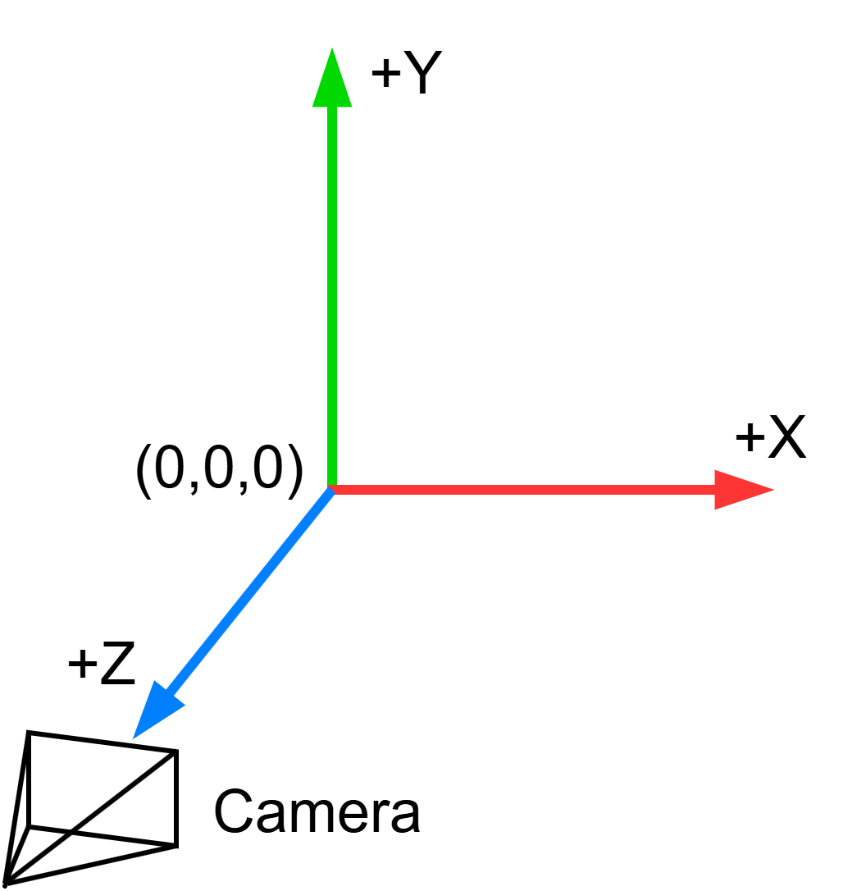

<p align="center">
    
</p>

<h1 align="center">A Lightweight and Differentiable Renderer for Joint Mesh and 3D Gaussian Splat Scenes</h1>


<a href="https://opensource.org/licenses/MIT">

</a>

**Current Version**: v1.1 (October 25, 2026)

### What's new in v1.1
- Textured meshes: a mesh is colored either by its vertex colors or by a texture map (with per-corner texture
  coordinates, as in OBJ files). Texture sampling is differentiable w.r.t. the texture map, so textures can be
  learned, with trilinear mipmapping by default (no aliasing when the texture is minified, and gradients reach all
  the texels a pixel covers).
- Lighting in the renderer: a `PointLight` shades the mesh per pixel (Phong shading with interpolated vertex normals).
  Vertex colors and texture maps are both the base color of the surface and are lit the same way; the light is set on
  the renderer (`GmeshRenderer(..., light=light)`) or per call (`render(..., light=light)`), and is differentiable
  (`PointLight(..., trainable=True)`).
- `gmesh.utils.mesh_io`: OBJ (with texture coordinates) and texture loading, no extra dependencies.
- Textured toy training example (`examples/train_textured_toy.py`, example 5): learn the texture map, and learn 3D
  Gaussians that mimic the textured mesh, from pre-rendered images of the textured mesh.
- Hybrid toy training example (`examples/train_hybrid_toy.py`, example 6): a textured mesh reconstructed from a sphere,
  then Gaussians added and both fine-tuned together, vs. Gaussians alone.
- Gaussians → mesh → hybrid example (`examples/train_gs2mesh_toy.py`, example 7): Gaussians from a random initialization,
  a mesh extracted from them (TSDF fusion + marching cubes), then the mesh plus fewer Gaussians trained together.

### What's new in v1.0
- Gmesh's own differentiable, tile-based CUDA mesh rasterizer (PyTorch3D is no longer used), with analytic edge
  antialiasing and gradients at silhouettes.
- True hybrid compositing: every Gaussian is depth-tested against the mesh surface at every pixel, with a soft
  split that follows the surface (no more blending of two separately rendered images).
- Differentiable w.r.t. both the Gaussians and the mesh (vertex positions and colors).
- Gaussians hidden behind the mesh are culled per tile before compositing.

## TL;DR

- Combining Gaussians and meshes lets you leverage the strengths of both for more flexible and realistic 3D scene rendering.
- Gmesh supports differentiable rendering of mixed 3D Gaussians and meshes within a single scene.
- Gmesh is fully PyTorch-native and self-contained: one CUDA extension with its own differentiable mesh rasterizer,
  hybrid compositing, and 3DGS projection kernels adapted from [gsplat](https://github.com/nerfstudio-project/gsplat).


## Examples

Please see ```./examples```:

1. 3D Mesh Rendering: [Link](./examples/example-1%20-%20mesh%20rendering.ipynb)
2. 3D Gaussian Splatting: [Link](./examples/example-2%20-%20gaussian%20splatting.ipynb)
3. Hybrid Gaussians and Mesh Rendering via Gmesh: [Link](./examples/example-3%20-%20gmesh%20hybrid%20rendering.ipynb)
4. Toy Training through the Hybrid Renderer (Gaussians, mesh, and both): [Link](./examples/example-4%20-%20toy%20training.ipynb)
5. Toy Training from a Textured Mesh (texture map, and Gaussians mimicking the mesh): [Link](./examples/example-5%20-%20textured%20mesh%20training.ipynb)
6. Mesh from a Sphere, then Mesh + Gaussians Trained Jointly (vs. Gaussians only): [Link](./examples/example-6%20-%20hybrid%20mesh%20and%20gaussians%20training.ipynb)
7. Gaussians → Mesh → Mesh + Fewer Gaussians (better quality with fewer parameters): [Link](./examples/example-7%20-%20gaussians%20to%20mesh%20to%20hybrid%20training.ipynb)


## Setup


```bash
# create conda virtual environment
conda create --name gmesh -y python=3.10
conda activate gmesh

# install cuda toolkit
conda install -c "nvidia/label/cuda-11.7.1" cuda-toolkit ninja
conda install -c conda-forge cudatoolkit=11.7 cudatoolkit-dev=11.7

# install gcc 11 (nvcc 11.7 needs gcc 11)
conda install -c conda-forge gcc=11 gxx=11

# install PyTorch
pip install torch==2.0.1 torchvision --index-url https://download.pytorch.org/whl/cu117

# install other dependencies
pip install --no-build-isolation -r requirements.txt

# install Gmesh
pip install --no-build-isolation -e .
```

> [!TIP]
> I have only tested the following library versions:
> ```CUDA 11.7``` and ```PyTorch 2.0.1```. gsplat is not needed (only optionally, to run the tests that
> compare Gmesh's ported kernels with it).
> The CUDA extension of Gmesh is JIT-compiled the first time it is used (this needs `nvcc` and `ninja`,
> installed above, and takes about a minute). It is built with the `nvcc` that PyTorch finds through `CUDA_HOME`
> (or `CUDA_PATH`, which a system-wide CUDA install sets on Windows); set `CUDA_HOME` to choose the toolkit.
> Any NVIDIA GPU with compute capability 6.0 or higher works (GTX 10xx and newer).
> If you encounter any issues or unexpected results, please double-check that you have installed the correct versions.


## Design Details

<p align="center">
    
</p>

### Mesh rasterizer

Meshes are rasterized by Gmesh's own differentiable rasterizer (`gmesh/renderer/rasterizer_mesh.py`), using exactly the
same pinhole camera and pixel convention as the Gaussians:

1. Triangles are binned into 16x16 tiles, and a CUDA kernel finds the nearest triangle at each pixel center (z-buffer).
   This visibility decision is the only non-differentiable step.
2. Barycentric coordinates, depth and vertex attributes (colors) are recomputed in PyTorch from the face ids, with
   perspective-correct interpolation, so autograd provides gradients w.r.t. vertex positions and vertex colors.
   For a textured mesh, the texture coordinates are interpolated the same way and the texture is sampled at each pixel
   (`gmesh/renderer/texture.py`), with gradients w.r.t. the texture map and the texture coordinates:
   - `texture_filter="mipmap"` (default): trilinear filtering of a mipmap pyramid, with the level of detail of each
     pixel from the screen-space derivatives of its texture coordinates (as on GPUs).
   - `texture_filter="bilinear"`: bilinear sampling of the full-resolution texture (sharper when the texture is
     minified, but it aliases, and only 4 texels per pixel receive gradients).
   With a `light` (`gmesh.scenes.light.PointLight`), these colors are lit per pixel (Phong shading with interpolated
   vertex normals, the specular highlight following the camera), with gradients w.r.t. the light's position and colors.
3. Edges are antialiased analytically (as in nvdiffrast): for every pair of neighboring pixels that sees a geometric
   discontinuity (a silhouette), the position where the front triangle's edge crosses between the two pixel centers
   gives a fractional coverage (and blends colors over a farther surface). This yields smooth silhouettes and
   gradients w.r.t. the silhouette vertex positions. Internal edges of a connected surface are left untouched.

Triangles with a vertex in front of the near plane are skipped (no near-plane clipping).

### Hybrid rendering

At every pixel, each Gaussian is split at the mesh surface into the part in front of it and the part behind it.
The Gaussian's depth at pixel `p` uses the same local affine (EWA) approximation as its 2D splat: the camera-space
depth conditioned on the projected position is Gaussian with mean `z*(p) = z_c + g . (p - mean2d)` and standard
deviation `sigma`, where `g = (Sigma_uv + eps I)^-1 Sigma_uv,z` and `sigma^2 = Sigma_zz - Sigma_z,uv g` come from the
projected 3D covariance (so a flat Gaussian lying on a tilted surface has a depth that tilts with it). The fraction
in front of the mesh depth `D` is

```
f = Phi((D - z*(p)) / (sigma * softness))
```

<p align="left">
    
</p>


The front parts (`alpha * f`) and back parts (`alpha * (1 - f)`) are alpha-composited into two layers, in the usual
sorted 3DGS order, and combined with the opaque mesh (coverage `a_m`, color `c_m`):

```
C = C_front + T_front * (a_m * c_m + (1 - a_m) * (C_back + T_back * bg))
```

- A Gaussian crossing the mesh is cut smoothly and *along the surface* (a flat Gaussian lying on a tilted surface
  tilts with it), instead of a per-pixel staircase, also for Gaussians lying on the surface.
- Everything is differentiable: Gaussian means, rotations, scales (also through the split), opacities and colors,
  and the mesh vertices (through the mesh depth and the interpolated colors).
- `softness` scales the width of the transition (1.0 = the Gaussian's own depth extent; smaller is sharper).
- With antialiased mesh edges, the coverage `a_m` is fractional at silhouettes, so Gaussians behind the mesh fade
  out smoothly at its outline instead of being cut along it.
- `cull_occluded=True` removes Gaussians that are certainly hidden behind the mesh in fully covered 16x16 tiles
  before compositing. This does not change the result (they would be skipped anyway) and saves time in scenes
  where the mesh hides many Gaussians.

The compositing is a custom CUDA kernel (forward and backward, `gmesh/renderer/csrc/rasterize_hybrid.cu`); the
projection, spherical harmonics and tile sorting kernels are adapted from gsplat v1.5.2 (`gmesh/renderer/csrc/gsplat`,
see the Acknowledgement), and the depth model is computed in PyTorch.

```python
gmesh_renderer = GmeshRenderer(camera=camera, tile_size=16, bg_color=(1.0, 1.0, 1.0), softness=1.0,
                               antialias=True, cull_occluded=True)
rgb, depth, alpha = gmesh_renderer.render(mesh=mesh, gaussians=gaussians, camera_pose=camera_pose)
```

<p align="center">
    <b>Camera Coordinates</b><br>
    
</p>


## Toy Training Example

```bash
python examples/train_toy.py                          # all three experiments (or see example 4, the notebook version)
python examples/train_toy.py --experiment gaussians   # or: mesh, joint
```

A sanity check that the hybrid renderer trains: the ground truth is the example mesh plus two rings of colorful
Gaussians passing *through* it (in front of it, behind it and crossing its surface), rendered from 24 orbit views.
From perturbed parameters, Adam (L1 loss) fits

- `gaussians`: the Gaussians (means, rotations, scales, opacities, colors), with the fixed mesh occluding them;
- `mesh`: a translation of the mesh and its vertex colors, with the Gaussians fixed (gradients through the
  silhouettes, the mesh depth vs. the Gaussians, and the color interpolation);
- `joint`: both at once.

It prints the loss and the PSNR on 6 held-out views (and the remaining mesh translation error), and saves test views
(ground truth | initialization | trained) and loss curves to `output/toy_training/`.


## Textured Mesh Training Example

```bash
python examples/train_textured_toy.py                          # both experiments (or see example 5, the notebook version)
python examples/train_textured_toy.py --experiment texture     # or: gaussians; --texture-filter bilinear
```

The textured Spot mesh (`assets/data/spot`), lit by a point light, is pre-rendered from 24 orbit views. From these
images, Adam (L1 loss) fits

- `texture`: the texture map, starting from a uniform gray one (the geometry and the light are known);
- `gaussians`: 3D Gaussians that mimic the mesh, without any mesh (plain 3DGS): means, rotations, scales, opacities and
  colors, starting from 3 Gaussians per triangle on the surface, with noisy positions, gray.

It prints the loss and the PSNR on 6 held-out views, and saves test views (ground truth | initialization | trained),
the loss curves and the learned texture next to the ground truth to `output/textured_toy_training/`.

## Hybrid Training Example: Mesh from a Sphere + Gaussians

```bash
python examples/train_hybrid_toy.py                            # (or see example 6, the notebook version)
python examples/train_hybrid_toy.py --mesh-iters 2000 --hybrid-iters 2000 --n-gaussians 4000
```

From pre-rendered images (color and silhouette) of the detailed textured Spot mesh:

- stage 1 (mesh): an icosphere (5120 triangles, sphere-mapped texture coordinates) is deformed into the object and its
  texture map learned. The vertices are optimized in the "large steps" parameterization `u = (I + lambda L) v`
  ([Nicolet et al. 2021](https://rgl.epfl.ch/publications/Nicolet2021Large)), with light smoothness regularizers;
- stage 2 (hybrid): Gaussians are added on the fitted mesh, and the mesh and the Gaussians are fine-tuned together: the
  mesh carries the large textured surfaces, the Gaussians the parts a deformed sphere hardly reaches (ears, horns);
- baselines: the same number of Gaussians alone, (a) from the sphere, for as many iterations as both stages, (b) from the
  stage 1 mesh, for as many iterations as stage 2 (the only difference to the hybrid model: the mesh is not rendered).

It reports the test PSNR of the three models and the Chamfer distance of the meshes to the ground-truth mesh, and saves
test views, the stage 1 progress, the decomposition of the hybrid model (its mesh, its Gaussians, both) and the fitted
mesh (OBJ) to `output/hybrid_toy_training/`.

## Gaussians → Mesh → Hybrid Example

```bash
pip install scikit-image                                       # marching cubes, only for this example
python examples/train_gs2mesh_toy.py                           # (or see example 7, the notebook version)
```

From the same pre-rendered images (no ground-truth geometry): N Gaussians from a random initialization are trained;
a mesh is extracted from them (their depth and silhouette from 60 views fused into a truncated signed distance
volume, then marching cubes); its vertices and vertex colors are trained; then N / 4 Gaussians are added and the mesh
and the Gaussians are trained together. It compares the test PSNR and the number of parameters with the stage 1
Gaussians trained further and with N / 4 Gaussians alone, and saves the extracted and trained meshes (OBJ) to
`output/gs2mesh_toy_training/`.

A textured mesh is created with texture coordinates and a texture map (`[Ht, Wt, 3]`, values in `[0, 1]`):

```python
from gmesh.utils.mesh_io import load_textured_mesh

mesh = load_textured_mesh("assets/data/spot/spot_triangulated.obj", "assets/data/spot/spot_texture.png",
                          device="cuda", trainable=True)  # the texture map is an nn.Parameter
# or: Mesh(verts=verts, faces=faces, uvs=uvs, faces_uv=faces_uv, texture=texture)
#     (a texture tensor with requires_grad, or an nn.Parameter, is trainable)

# lighting, the same for vertex colors and textures (both are the base color of the surface)
from gmesh.scenes.light import PointLight
light = PointLight(position=(2.0, 2.0, 8.0), specular=(0.2, 0.2, 0.2), device="cuda")  # trainable=True to learn it
renderer = GmeshRenderer(camera=camera, light=light)        # default light of the renderer (None: unlit)
rgb, depth, alpha = renderer.render(mesh=mesh, gaussians=gaussians, camera_pose=camera_pose)  # or render(..., light=...)
```


## Tests

The tests need a CUDA GPU (the renderer tests also need open3d to read the example mesh). The tests that compare
Gmesh's ported kernels with gsplat itself need gsplat v1.5.2 and are skipped without it:

```bash
pip install git+https://github.com/nerfstudio-project/gsplat.git@v1.5.2   # optional, for the comparisons
python -m pytest tests -v
```

They check the ported projection, tile intersection, spherical harmonics and plain 3DGS rendering against gsplat
(forward and gradients); the hybrid compositing against gsplat (no mesh) and against a brute-force PyTorch reference
(with a mesh), for both the forward pass and the gradients; that occlusion culling does not change the result; the
mesh rasterizer against a brute-force rasterizer, supersampling (antialiasing) and finite-difference gradients; and
that the mesh is pixel- and depth-aligned with the Gaussians.


## Benchmark

```bash
python benchmarks/benchmark_renderer.py --width 1024 --height 768 --extra-gaussians 200000 --backward
```

Times (per frame, forward and forward + backward) the Gmesh mesh rasterizer, plain 3DGS, the hybrid renderer
(with and without antialiasing / occlusion culling), and, for reference, the mesh and the Gaussians rendered
separately (without occlusion between them).


## Demo

You can play with our interactive demonstration to see the rendering results: 

```bash
python interactive_demo.py
```

<p align="center">
    <a href="https://youtu.be/LhAtS1K2f9s?si=XhwSXLdoVl6Wql-9">
        
    </a>
    <br>
    <a href="https://youtu.be/LhAtS1K2f9s?si=XhwSXLdoVl6Wql-9">Watch the demo video on YouTube</a>
</p>


## Limitations and Todos

### The current version has the following main limitations:
- Gaussians are still sorted by their center depth (as in 3DGS); only the split against the mesh is per pixel.
- One opaque mesh layer (no transparent meshes).
- Edge antialiasing is a per-axis 1D approximation (exact for straight edges away from corners).
- No near-plane clipping of triangles.
- 3D Gaussians are not relightable (fixed SH colors).
- Texture filtering is isotropic (trilinear mipmapping, no anisotropic filtering), and texture coordinates outside
  `[0, 1]` are clamped to the border (no wrapping).
- Lighting: a single point light with Phong shading (no shadows, no environment lighting); 3D Gaussians are not lit.
- No mesh opacity (the mesh is fully opaque).
- Does not support batch rendering.

### Todos:
- [x] Per-pixel depth test between Gaussians and the mesh (v1.0).
- [x] Own differentiable mesh rasterizer and soft hybrid compositing (v1.0).
- [x] Anti-aliased mesh edges (fractional coverage and silhouette gradients) (v1.0).
- [x] Skip Gaussians hidden behind fully covered tiles (v1.0).
- [x] Support mesh texture map, differentiable (v1.1).
- [x] Per-pixel mesh lighting in the renderer (v1.1).
- [ ] Support batch (batch of camera poses) rendering.
- [x] Add a toy training example (v1.0).
- [ ] Add more training examples (e.g. real multi-view data, densification).


## Acknowledgement and Disclaimer

Gmesh's 3D Gaussian projection, tile intersection and spherical harmonics kernels, and parts of its hybrid compositing
kernels, are adapted from [gsplat](https://github.com/nerfstudio-project/gsplat) v1.5.2 (Copyright the gsplat authors,
Apache License 2.0); see [gmesh/renderer/csrc/gsplat/README.md](./gmesh/renderer/csrc/gsplat/README.md) for the list of
files and changes, and [its license](./gmesh/renderer/csrc/gsplat/LICENSE). These kernels use
[GLM](https://github.com/g-truc/glm) (MIT License), included in `gmesh/renderer/csrc/third_party/glm`. If you use Gmesh,
please also cite gsplat.

The code can be used for research purposes, **provided that the terms of the licenses of any third-party libraries, data or dependencies are followed**. For commercial use, the parts of code we wrote are for free, but please be aware to get permissions from any third-party to use their code or dependencies. We do not assume any responsibility for any issues, damages, or liabilities that may arise from the use of this code. Users are responsible for ensuring compliance with any legal requirements, including licensing terms and conditions, and for verifying that the code is suitable for their intended purposes.

> [!NOTE]
> The example 3D mesh used in ./assets/data/spot.obj is sourced from: https://www.cs.cmu.edu/~kmcrane/Projects/ModelRepository/#spot. Please ensure you adhere to the license agreement provided on that site. We do not claim ownership of this mesh file.


## 🧸 Citation

Please cite this work if you find it useful in your projects. 

```bibtex
@software{Yan_GMesh_Differentiable_Hybrid_2025,
    author = {Yan, Peizhi},
    month = jul,
    title = {{GMesh: Differentiable Hybrid Renderer for 3D Gaussians and Meshes}},
    url = {https://github.com/PeizhiYan/gmesh},
    version = {1.1},
    year = {2025}
}
```

